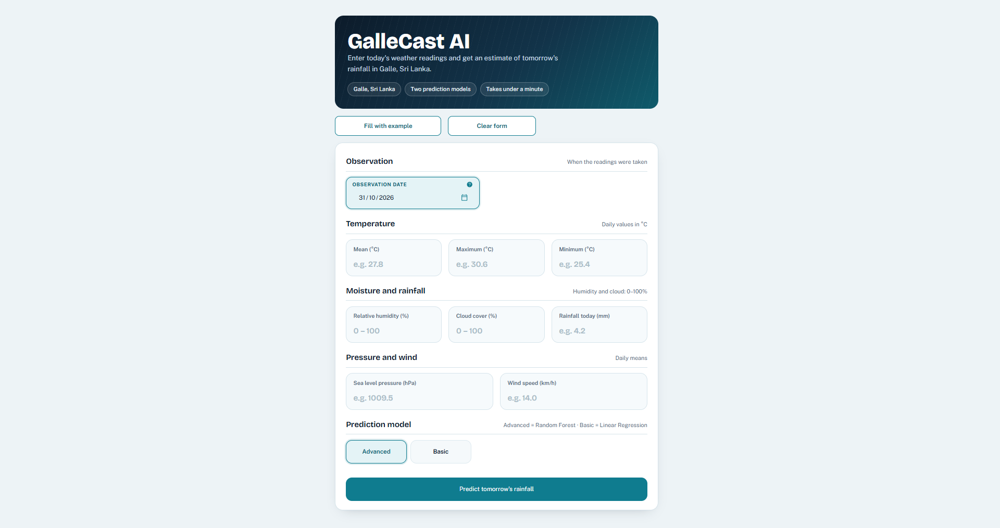
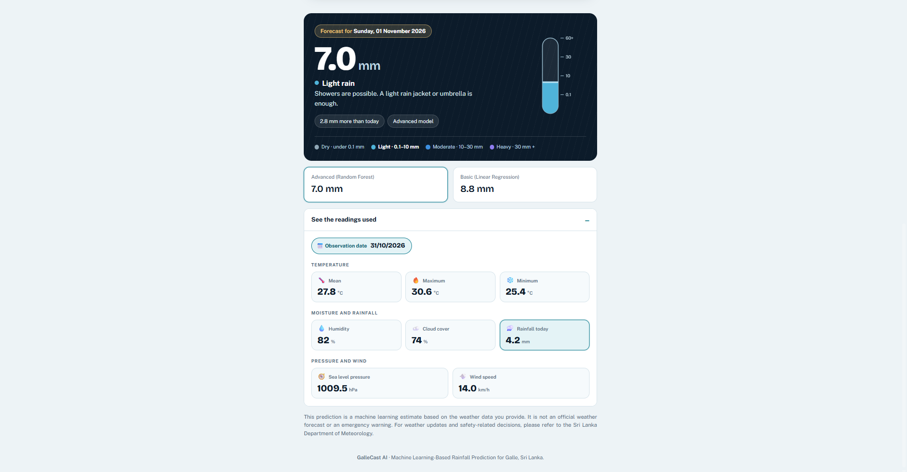

# Hi, I'm Zayyan Zameeth 👋

### AI & Machine Learning Engineer | Computer Engineering Undergraduate

I'm a Computer Engineering undergraduate passionate about Artificial Intelligence, Machine Learning, and building intelligent software solutions. I enjoy exploring emerging technologies and developing practical solutions using AI, automation, and software engineering.

- 🎓 BSc (Hons) Engineering – Computer Engineering, Open University of Sri Lanka
- 🤖 Interested in AI, Machine Learning, Deep Learning, and Generative AI
- 🧠 Exploring Large Language Models (LLMs), RAG, and AI Agents
- ⚙️ Experienced with AI automation and workflow development
- 🚀 Continuously learning and building practical engineering projects

---

### 🛠️ Technical Skills

**💻 Programming Languages**
- Python, Java, SQL

**📊 Data Analysis**
- Pandas, NumPy, Matplotlib, Seaborn
- Exploratory Data Analysis (EDA), Data Cleaning

**🤖 Machine Learning**
- Scikit-learn
- Supervised and Unsupervised Learning
- Feature Engineering, Model Evaluation
- Neural Networks

**🧠 Deep Learning**
- TensorFlow, Keras

**✨ LLM & Generative AI**
- Large Language Models (LLMs)
- Retrieval-Augmented Generation (RAG)
- Prompt Engineering, Hugging Face
- AI Chatbot Development

**⚙️ AI Automation**
- n8n, REST APIs, AI Agents
- Workflow Automation

**🗄️ Backend & Databases**
- ASP.NET Core
- PostgreSQL, MySQL

**🔧 Tools & Development Environments**
- GitHub, Google Colab, VS Code
- Jupyter Notebook, Anaconda

---

### 🚀 Featured Projects

**1. GalleCastAI – Next-Day Rainfall Prediction System**

- Developed a machine learning application for next-day rainfall prediction in Galle, Sri Lanka.
- Implemented Linear Regression and Random Forest models.
- Built an interactive dashboard using Streamlit.

**Technologies:** Python, Pandas, NumPy, Scikit-learn, Streamlit.

[View Project on GitHub](https://github.com/zayyanzameeth/GalleCastAI)

**2. MyOUSL AI Chatbot**

- Developing a university student-support chatbot using Retrieval-Augmented Generation (RAG).
- Working with Ollama, n8n, Supabase, and ASP.NET Core REST APIs.
- Focused on retrieving accurate university-related information.

**3. Machine Learning Projects**

- Exploring supervised and unsupervised learning.
- Working on data preprocessing, model training, and evaluation.
- Applying Python-based machine learning tools.

**4. Engineering & Automation Projects**

- Developing automation workflows and API integrations.
- Exploring practical applications of AI and intelligent systems.

---

### 📚 Currently Learning

- Advanced Machine Learning and Deep Learning
- Generative AI and Large Language Models
- AI Agents and Agentic Workflows
- Cloud Computing and AWS
- MLOps and AI Model Deployment

---

### 🤝 Connect With Me

- LinkedIn: [Zayyan Zameeth](https://www.linkedin.com/in/zayyan-zameeth-22341019a/)
- GitHub: [zayyanzameeth](https://github.com/zayyanzameeth)
- Email: [zayanzameek@gmail.com](mailto:zayanzameek@gmail.com)

---

⭐ *Always learning, building, and exploring the possibilities of AI and technology.*